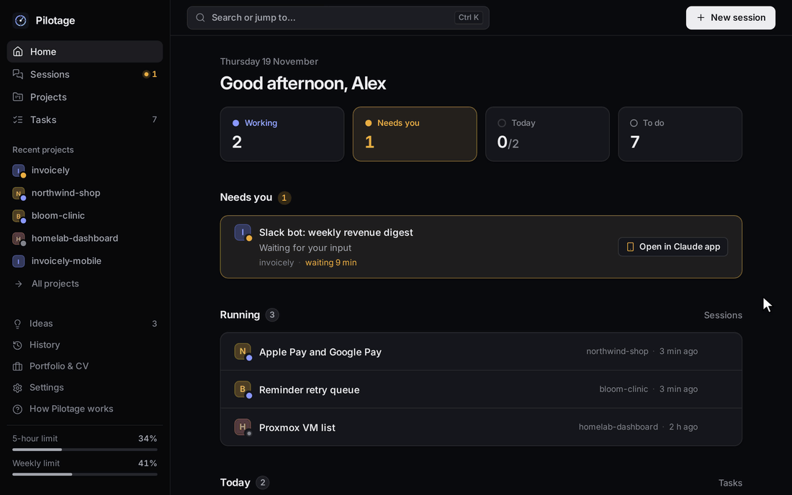
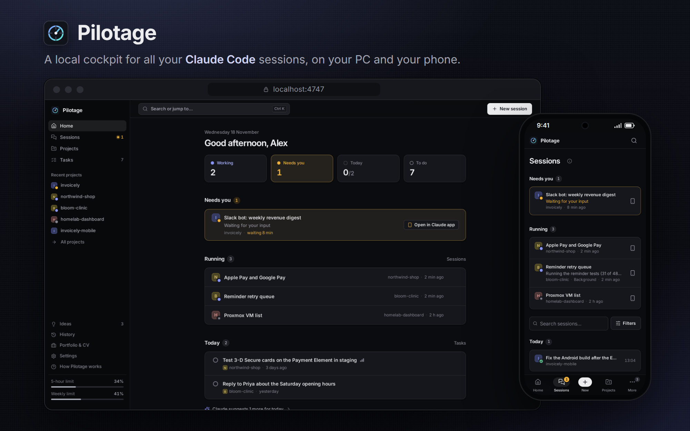
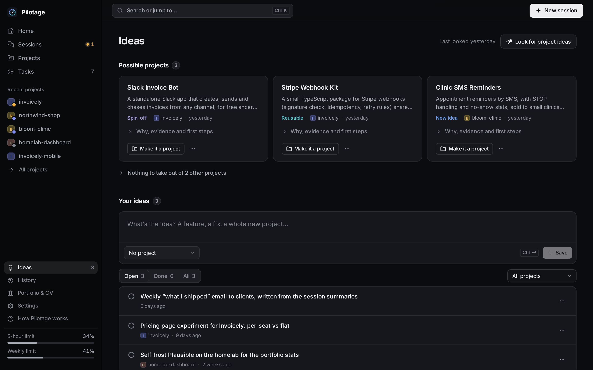
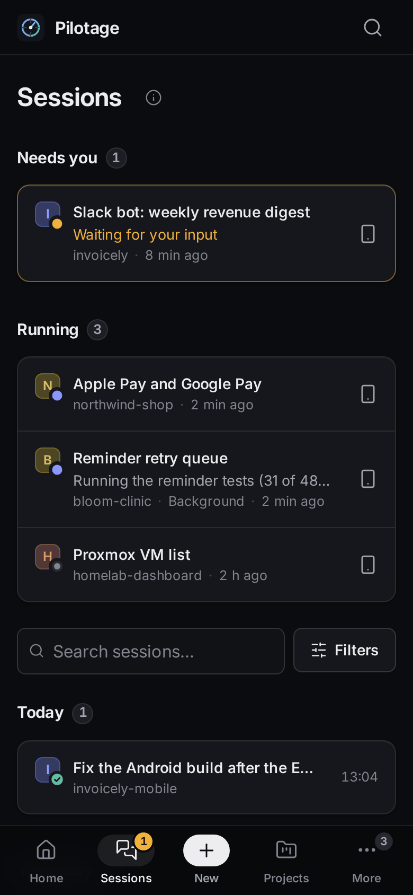

# Pilotage

A local web cockpit for everything you build with Claude Code (and Codex or Gemini CLI): your projects, what is
running right now, AI summaries of your sessions, and a task list that fills itself. On your PC or your phone.

[](https://github.com/Ya-zid/pilotage/actions/workflows/ci.yml)
[](LICENSE)
[](https://nodejs.org/)
[](CONTRIBUTING.md)



Pilotage reads the session transcripts your coding agents already write on your computer, groups them by project,
and shows them in a web app. It never changes your projects or your agents' files, and nothing leaves your computer
except the AI calls you allow.

> **Status: early.** Built for one person's daily workflow (Claude Code all day), used every day, mostly on WSL2.
> It runs on macOS, Linux and WSL2 + Windows. Expect rough edges and please [report them](#contributing).

## Quick start (5 minutes)

**1. You need** Node.js 22 or later (`node -v`) on macOS, Linux, or Windows 10/11 with WSL2. On Windows, do
everything below **in your Ubuntu (WSL) terminal**, not in PowerShell. [Claude Code](https://claude.com/claude-code)
should be installed and logged in for summaries and for starting sessions (browsing works without it). No Node 22?
`nvm install 22` with [nvm](https://github.com/nvm-sh/nvm).

**2. Run it:**

```bash
npx pilotage-cli
```

It starts Pilotage on this computer and opens it in your browser with a one-time sign-in. It also prints that
sign-in link: if no browser window appears, open the link yourself within 2 minutes (or run `npx pilotage-cli open`
for a fresh one).

**3. Look around.** The first start reads your existing sessions (seconds to a minute), then summarizes the last 30
days of work in the background, a few sessions at a time, within [AI limits](#ai-cost-and-usage) you control.

**4. Keep it** (and start it at login):

```bash
npm install -g pilotage-cli
pilotage install
```

`pilotage install` adds a login item on macOS, a systemd user service on Linux, and on WSL a Windows Startup entry
plus a Desktop shortcut. Update later with `npm install -g pilotage-cli@latest && pilotage restart`. Your data stays
in `~/.pilotage`.

**Something off?** Run `pilotage doctor` (or `npx pilotage-cli doctor`): it checks Node, Claude Code, ports, PATH,
Windows Terminal and autostart, and says how to fix what's missing. Also see [Troubleshooting](#troubleshooting).

> **Sessions you start from Pilotage ask before commands and edits** (Claude Code's default mode). If you'd rather
> they don't stop to ask, like `claude --dangerously-skip-permissions`, pick **Skip all prompts** in **Settings → New
> sessions → Permissions**; Pilotage then says so in every New session dialog. Installs from before 0.4.0 keep the
> mode they had (Skip all prompts).

For the **phone**: Settings → Phone & security, then pair with a QR code. Guide: [docs/PHONE.md](docs/PHONE.md).

## Contents

- [What it does](#what-it-does)
- [Troubleshooting](#troubleshooting)
- [From source](#from-source)
- [Platforms](#platforms)
- [Commands](#commands)
- [How it works and privacy](#how-it-works-and-privacy)
- [Configuration](#configuration)
- [AI cost and usage](#ai-cost-and-usage)
- [Phone access](#phone-access)
- [FAQ](#faq)
- [Contributing](#contributing) · [Roadmap](#roadmap-and-help-wanted) · [Security](#security) · [License](#license)

## What it does

| Page | What it's for |
|---|---|
| **Home** | At a glance: what's working, what needs you, today's plan (AI-proposed, you pick) and a "pick up" list of work you can resume, one line each |
| **Sessions** | Every session from Claude Code, Codex and Gemini CLI, with running ones on top (Needs you · Working · Open). Read the conversation, resume or fork it, open it in the Claude app |
| **Tasks** | To do · Doing · Done, plus **Suggested**: short to-dos the AI finds in your sessions, marked You or Claude. You keep or dismiss them; nothing lands on your board without you |
| **Projects** | Every git repo or project folder, grouped by workspace (top-level folder), with an AI summary, workstreams, sessions, worktrees, notes and docs (incl. Claude memory files) |
| **Ideas** | Your captured ideas, plus **possible projects** the project scout spotted: a tool you built inside another project, or a project you said you'd like to build |

Also: **History** (year heatmap, "what did I do that day / week"), **Portfolio & CV** (AI-written project entries,
EN/FR), **Spin off** (turn part of a project into a new folder with a `CLAUDE.md` handoff written from your past
sessions), and starting or resuming sessions from the browser or your phone.

- **Multi-harness.** Claude Code (`~/.claude`, and the Windows-side `~/.claude` on WSL), Codex CLI (`~/.codex`) and
  Gemini CLI (`~/.gemini`). More Claude config folders (a second account) can be added in Settings.
- **AI summaries with a usage guard.** Work is cut into blocks (a stretch of prompts without a 4-hour gap). Each
  block gets a short summary (Haiku by default), each project a summary and workstreams, each day a plan. Results
  are cached and only redone when their input changes.
- **Project scout.** Now and then, one call per active project (Sonnet by default) looks for parts of your work that
  deserve their own project. Most runs find nothing, which is the intended outcome.
- **Phone access** over your home Wi-Fi or a VPN (NetBird, Tailscale), paired with a QR code.
- **Live.** Pages update by themselves (server-sent events); you never press refresh.

<details>
<summary>More screenshots (fictional demo data)</summary>



| | |
|---|---|
|  |  |
|  |  |
|  |  |

</details>

## Troubleshooting

Start with `pilotage doctor`. The common cases:

| You see | Do this |
|---|---|
| "This device isn't paired yet" at `http://127.0.0.1:4747` or `localhost:4747` | Run `pilotage open`. Sign-in is per address, and the PC signs in at `http://pilotage.localhost:4747`, which `pilotage open` opens for you |
| No browser window opened | Use the link `pilotage open` printed (valid 2 minutes), or run it again |
| `node: command not found`, or "Node.js 22+ not found" | Install Node 22: `nvm install 22` |
| On Windows: `'bash' is not recognized`, or npm errors about the platform | Run the commands in your Ubuntu (WSL) terminal |
| `pilotage: command not found` after `pilotage install` | Open a new terminal. Still missing: add `~/.local/bin` (git clone) or npm's global bin folder to your `PATH` |
| `EACCES` from `npm install -g` | Use Node from nvm, or set a user prefix: `npm config set prefix ~/.npm-global` and add `~/.npm-global/bin` to `PATH` |
| No summaries; Settings → AI says Claude is logged out or not found | Run `claude`, then `/login`. Too old: `claude update` |
| WSL: sessions start "in the background" instead of a terminal tab | Install Windows Terminal from the Microsoft Store (Windows 10 doesn't have it). Background sessions continue in the Claude app or `claude attach <id>` |
| WSL: Pilotage stops when you close the Ubuntu window | Windows can shut WSL down when its last window closes. `pilotage install` keeps Pilotage running from Windows' login |
| Port 4747 is taken | `PILOTAGE_PORT=4757 pilotage start` |
| The phone can't connect | See [docs/PHONE.md](docs/PHONE.md): same Wi-Fi (trusted) or VPN, the forwarder running (`pilotage status`) |

## From source

To hack on it (Node 22, git):

```bash
git clone https://github.com/Ya-zid/pilotage.git ~/pilotage
cd ~/pilotage
npm install && npm --prefix web install
bin/pilotage build      # builds the web app into web/dist (about 10 s)
bin/pilotage            # starts the server and opens it in your browser
bin/pilotage install    # optional: `pilotage` on your PATH (~/.local/bin), plus autostart
```

A clone keeps its data in its own `data/` folder. `npm --prefix web install` may report audit warnings for build
tools; they don't affect the running app. To try it without your own data, `scripts/demo/run-demo.sh` starts it on a
fictional world (see [CONTRIBUTING.md](CONTRIBUTING.md#try-the-demo-world)).

## Platforms

| | macOS | Linux | WSL2 + Windows |
|---|---|---|---|
| Sessions, projects, tasks, summaries, scout, history | yes | yes | yes |
| Start a session from the browser | a Terminal window, or background | your terminal emulator (in a desktop session), or background | a Windows Terminal tab, or background |
| Codex / Gemini sessions | read + start in a terminal | read + start in a terminal | read + start in a terminal tab |
| Open in VS Code / folder | `code` / Finder | `code` / `xdg-open` | VS Code / Explorer |
| Windows-side Claude Code history | n/a | n/a | yes |
| Phone access | direct bind with `PILOTAGE_LAN_BIND`, see [docs/PHONE.md](docs/PHONE.md#linux-and-macos) | same as macOS | Windows forwarder + firewall rule |
| `pilotage install` | login item (LaunchAgent) | systemd user service | autostart at Windows login, Desktop shortcut |

Sessions started from the browser open where you'd type yourself, with Remote Control on, so they also show in the
Claude app on your phone. On macOS that is Terminal (set `PILOTAGE_TERMINAL=iTerm` for iTerm). On Linux it's the
first terminal found: `x-terminal-emulator`, GNOME Terminal, Konsole, kitty, Alacritty, WezTerm, Ghostty, foot,
xterm and a few others, or the one in `PILOTAGE_TERMINAL`. Over SSH, with no desktop, or on WSL without Windows
Terminal, sessions start in the background (`claude --bg`; type in one with `claude attach <id>`).

## Commands

```
pilotage              # start if needed, then open in the browser (signs you in)
pilotage doctor       # check the install and say how to fix what's missing
pilotage status       # running? phone forwarder? firewall rule? autostart?
pilotage version      # installed version, short commit, and the running server's version
pilotage open         # open in the browser with a fresh one-time sign-in link (printed too)
pilotage start | stop | restart
pilotage logs         # follow the server log (Ctrl+C to stop following)
pilotage phone        # enable phone access (WSL: one Windows admin prompt)
pilotage pair         # QR code in the terminal to pair a phone
pilotage projects     # list projects            pilotage live   # what's running
pilotage new <project> [--bg] [--model sonnet] "first prompt"   # start a session (your agents can use this too)
pilotage build        # rebuild the web app (a git clone)
pilotage rotate-key   # replace the desktop key the CLI uses
pilotage install      # `pilotage` on your PATH + autostart at login
pilotage uninstall    # stop it and remove autostart, shortcut, forwarder, command, firewall rule
                      #   (keeps your data; --purge deletes it)
pilotage run          # the foreground supervisor autostart uses (restarts the server if it crashes)
```

From a clone, use `bin/pilotage` until `pilotage install` puts the command on your PATH.

## How it works and privacy

- A small Node server (no framework) on **127.0.0.1:4747**. It indexes transcripts **read-only**: `~/.claude`,
  `~/.codex`, `~/.gemini`, your git repos and project folders under your home folder. Git runs with
  `--no-optional-locks`, no hooks, no network, and never runs a program a repo's own config names (a downloaded
  repo is untrusted).
- A React web app (Vite) served by that server. Every page and API call needs a **paired device**.
- Pilotage writes only to its own data folder (`~/.pilotage`, or `data/` in a clone), to new folders you explicitly
  create with Spin off / New project, and, if you run `pilotage install`, to its autostart entry (see
  [Platforms](#platforms)). One opt-in exception: with Settings → Trust folders, or the checkbox when starting a
  session, it answers Claude Code's "trust this folder?" for you, which sets one flag in `~/.claude.json`.
- **Nothing leaves your computer except AI calls**, and those go to the provider you choose. By default that is your
  own `claude -p` (your Claude subscription), run with no tools, no MCP servers and no session files, in an empty
  sandbox folder. Common secret formats (API keys, tokens, passwords in `KEY=value` form, private keys, database
  URLs) are masked before anything is stored or sent, in transcripts and in everything else a summary reads
  (CLAUDE.md, memory files, READMEs). Passwords typed in plain words are not detected.
- A paired device can start coding sessions on the PC, so treat a paired phone like your PC's keyboard. Pilotage
  listens on 127.0.0.1 only, pairing codes are one-time, and pairing, devices, keys, the firewall and AI providers
  can only be changed from the PC. Details and the threat model: [SECURITY.md](SECURITY.md).

For contributors, [docs/ARCHITECTURE.md](docs/ARCHITECTURE.md) shows how requests and data flow through the code.

## Configuration

Almost everything is in **Settings** (saved in `state.json` in the data folder): your name (used in the greeting
and in what the AI writes; defaults to the first word of your git `user.name`, else your login name), AI provider
and models, usage limits, extra folders to scan, hidden folders, workspace names, launch defaults (permission mode,
model, terminal or background), theme.

Environment variables:

| Variable | Default | What it does |
|---|---|---|
| `PILOTAGE_PORT` | `4747` | Port for the PC browser and the CLI |
| `PILOTAGE_LAN_INTERNAL_PORT` | `PORT - 1` | Loopback port the phone forwarder targets |
| `PILOTAGE_LAN_PORT` | `4748` | Port phones connect to (the forwarder on Windows, or the direct bind) |
| `PILOTAGE_LAN_BIND` | unset | Linux/macOS: address the phone listener binds directly (e.g. `0.0.0.0`, or `::` for IPv6 and IPv4). Unset = no phone access outside WSL |
| `PILOTAGE_LAN_ALLOW` | `lan,vpn` | With `PILOTAGE_LAN_BIND`: who may connect (`lan`, `vpn`, IPv4 or IPv6 CIDRs, comma-separated) |
| `PILOTAGE_DATA` | `~/.pilotage` (`./data` in a clone) | Where state, caches, summaries and tokens live |
| `PILOTAGE_TERMINAL` | auto | macOS: the app sessions open in (`Terminal`, `iTerm`). Linux: the terminal emulator (`kitty`, `/usr/bin/foot`…). `none` = always in the background |
| `PILOTAGE_NO_AI` | unset | `1` = never call an AI provider |
| `PILOTAGE_USE_ANTHROPIC_API_KEY` | unset | `1` = let summaries use `ANTHROPIC_API_KEY` / `ANTHROPIC_AUTH_TOKEN` from the environment (billed to the API account). By default they're left out, so summaries run on your Claude login |
| `PILOTAGE_NO_FORWARDER` | unset | `1` = don't start the Windows phone forwarder |
| `PILOTAGE_NO_RELAY_WATCH` | unset | `1` = WSL: don't re-open the listeners when Windows loses its connection to them |
| `PILOTAGE_WSL` | detected | `0` / `1` to force the platform detection |
| `PILOTAGE_WIN_HOME` | detected | Your Windows profile seen from WSL (`/mnt/c/Users/<you>`) |
| `PILOTAGE_OPENSSL` | `openssl` | The openssl binary used to create the phone HTTPS certificates |
| `PILOTAGE_NODE` | detected | Node.js binary for `bin/pilotage` |
| `CODEX_HOME` | `~/.codex` | Codex CLI's own setting; Pilotage reads Codex sessions from there |

Workspaces are the top-level folders under your home (`~/acme/api` and `~/acme/web` are both in "acme"). Rename
them in Settings. To fold one top folder into another workspace, add `"workspaces": {"acme-old": {"mergeInto":
"acme"}}` to `state.json` while Pilotage is stopped. If that file ever stops parsing, Pilotage keeps it aside as
`state.json.corrupt-<time>` and starts from the newest backup in `backups/`.

## AI cost and usage

By default every AI call is a headless `claude -p` on **your Claude subscription**: Haiku for session summaries,
project summaries and today's plan, Sonnet for CV entries and the project scout. You can pick other models, or
another provider in Settings → AI: Codex CLI (`codex exec`), or any OpenAI-compatible API (DeepSeek, OpenRouter,
OpenAI, Groq, local Ollama). API keys are stored only in `data/secrets.json` (mode 600), never shown again, and can
only be changed from the PC.

Guards, all adjustable in Settings → AI:

- Automatic summaries cover the **last 30 days** of work; older work is summarized only when you press "Summarize
  now" (`"ai": {"backfillDays": 30}` in `state.json` changes the window).
- Pilotage caps its own calls: **500 per 5 hours and 1,500 per day** (non-Claude providers: 300 a day).
- Automatic work **pauses above 60% of your 5-hour limit and above 92% of your weekly limit**. Claude Code passes
  those numbers (`rate_limits`) to your statusline command; Pilotage reads them from `~/.claude/rate_limits.json`,
  which a statusline script can save (example below). Without that file only the call caps apply.
- **Pause** (Settings → AI) stops all automatic work until you resume, across restarts. `PILOTAGE_NO_AI=1` turns AI
  off for that server entirely.

<details>
<summary>A statusline script that saves the usage numbers</summary>

`~/.claude/statusline.py`, enabled with `"statusLine": {"type": "command", "command": "python3 ~/.claude/statusline.py"}`
in `~/.claude/settings.json`:

```python
#!/usr/bin/env python3
import json, os, sys, time
data = json.load(sys.stdin)
rl = data.get("rate_limits")
if rl:  # {"five_hour": {"used_percentage", "resets_at"}, "seven_day": {...}}
    p = os.path.expanduser("~/.claude/rate_limits.json")
    with open(p + ".tmp", "w") as f:
        json.dump({"saved_at": int(time.time()), **rl}, f)
    os.replace(p + ".tmp", p)
print((data.get("model") or {}).get("display_name", ""))
```

</details>

## Phone access

Pair a phone from **Settings → Devices → Pair a phone** (or `pilotage pair`) and use Pilotage over your home Wi-Fi or
a VPN (NetBird, Tailscale). Nothing is reachable from the internet. On WSL2, a small forwarder on Windows lets phones
in, only from your trusted Wi-Fi and VPN ranges (it needs Node.js installed on Windows); on Linux and macOS you turn
on a direct bind with `PILOTAGE_LAN_BIND`. Pilotage can also serve HTTPS so the phone can install it as an app.

The full guide (pairing, HTTPS certificate on Android and iPhone, Linux/macOS setup, security notes):
[docs/PHONE.md](docs/PHONE.md).

## FAQ

**Does it send my code or transcripts anywhere?** Only to the AI provider you configured, as short summaries of
your prompts and the agent's final replies (plus project docs for project summaries), with secrets masked. With
`PILOTAGE_NO_AI=1`, nothing.

**Will it change my repos?** No. It reads them. It only creates new folders when you ask (Spin off / New project).

**Claude Code deleted my old transcripts.** Claude Code removes transcripts after about 30 days by default.
Pilotage keeps its summaries and reads `~/.claude/history.jsonl`, so older work stays visible as "archived" sessions
(prompts only).

**Why is the first run busy?** It indexes every transcript once, then summarizes the last 30 days in the
background. Later runs only look at what changed.

**Can I run it on a server?** It is built for one person on their own computer. It binds to 127.0.0.1 on purpose.

**Where did it get my name?** From the first word of your git `user.name`, else your login name. Change it in
Settings → General.

## Contributing

Contributions are welcome: bug reports, tests on Linux and macOS, documentation, fixes and features.

- Start with [CONTRIBUTING.md](CONTRIBUTING.md): setup, where things live, checks to run, and the ground rules
  (read-only toward your projects and agent folders, security stays tight, no personal data).
- Looking for something to do? Try a
  [good first issue](https://github.com/Ya-zid/pilotage/issues?q=is%3Aissue+is%3Aopen+label%3A%22good+first+issue%22).
- Questions and ideas: [Discussions](https://github.com/Ya-zid/pilotage/discussions). Bugs and feature requests:
  [Issues](https://github.com/Ya-zid/pilotage/issues).

```bash
npm test                          # server tests (node:test): temp data dirs, no AI, no forwarder
cd web && npx tsc --noEmit -p .   # type-check the web app
npm run leak-scan                 # no personal data or secrets in what you commit
```

This project follows a [Code of Conduct](CODE_OF_CONDUCT.md). It is a side project with one maintainer, so replies
may take a while. Changes are listed in [CHANGELOG.md](CHANGELOG.md).

## Roadmap and help wanted

- **Testing on real machines.** Install reports from macOS and Linux help most: terminal launches with your
  terminal app, the login item or systemd service, phone HTTPS with macOS's own `openssl`.
- **Phone access.** IPv6 works on the direct bind over http only: the certificate covers IPv4 addresses (`server/tls.js`),
  and the Windows forwarder is IPv4-only (`windows/forwarder.js`).
- **More session sources.** Codex and Gemini are adapters in `server/sources/harness/`; other coding agents could
  follow the same shape (`harness/common.js` describes it).
- **Web app tests.** The web app has static contract checks (`tests/web-contract.test.js`) but no browser tests yet.

Before starting on one of these, open an issue or a discussion so we can agree on the shape.

## Security

Please report vulnerabilities privately through
[GitHub's private vulnerability reporting](https://github.com/Ya-zid/pilotage/security/advisories/new), not in a
public issue. The threat model and how authentication works: [SECURITY.md](SECURITY.md).

## Not affiliated with Anthropic

Pilotage is an independent open-source project. It is not affiliated with, endorsed by or sponsored by Anthropic,
OpenAI or Google. Claude and Claude Code are products of Anthropic; Codex is a product of OpenAI; Gemini CLI is a
product of Google. Pilotage reads the files these tools write on your computer and runs their command-line tools.

## License

[MIT](LICENSE). Made by [Yazid Slimani](https://github.com/Ya-zid).
