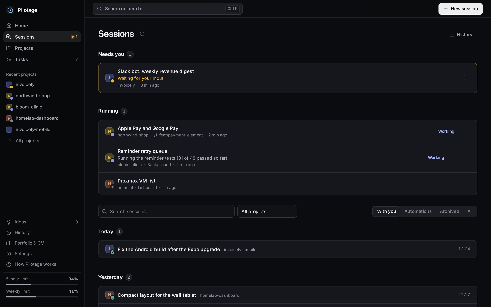
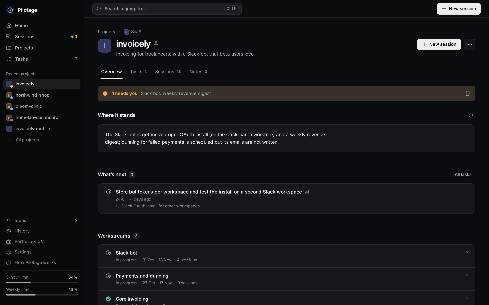
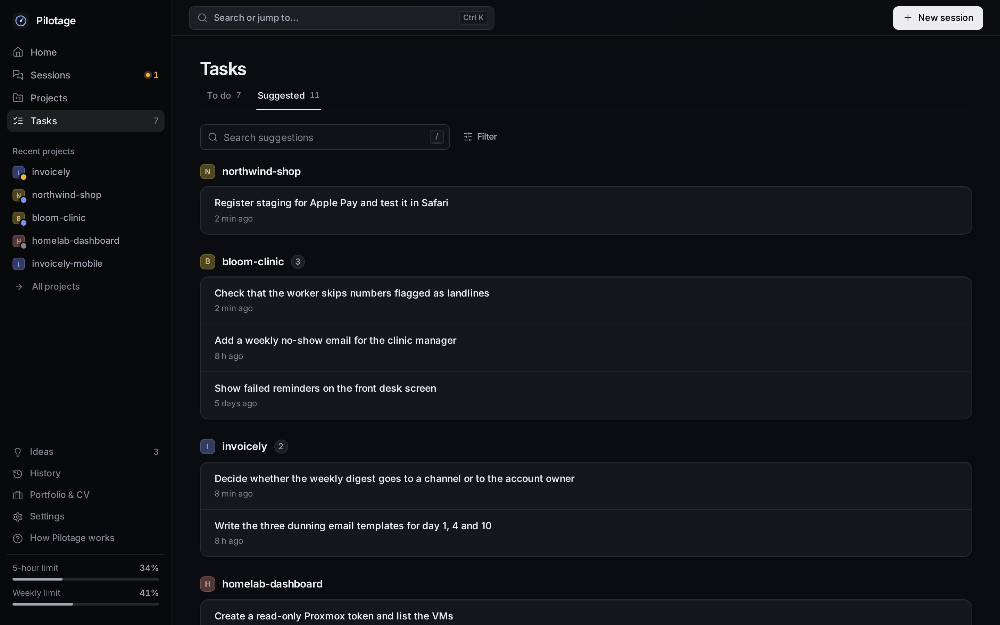
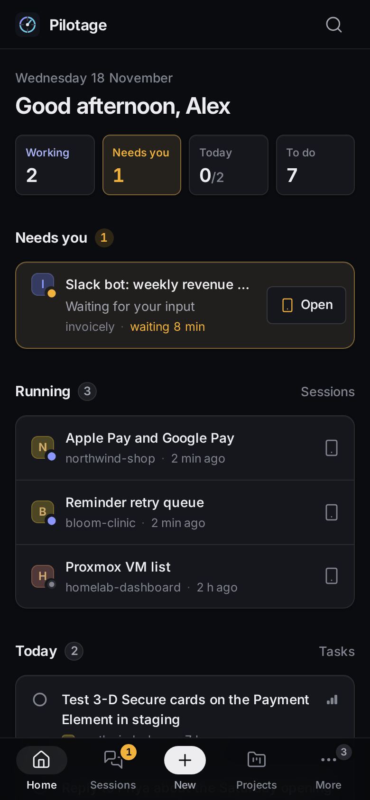

# Pilotage

A local web cockpit for everything you build with Claude Code (and Codex or Gemini CLI): your projects, what is
running right now, AI summaries of your sessions, and a task list that fills itself.

[](https://github.com/Ya-zid/pilotage/actions/workflows/ci.yml)
[](LICENSE)
[](https://nodejs.org/)
[](CONTRIBUTING.md)


Pilotage reads the session transcripts your coding agents already write on your computer, groups them by project,
and shows them in a web app you open on your PC or your phone. It never changes your projects or your agents' files.

> **Status: early.** I built it for my own daily workflow (WSL2 on Windows, Claude Code all day) and use it every
> day. It works best on WSL2 + Windows; plain Linux and macOS work with a smaller feature set (see
> [Platforms](#platforms)). Expect rough edges, and please [report them](#contributing).

## Contents

- [What it does](#what-it-does)
- [Quick start](#quick-start)
- [Requirements](#requirements)
- [Platforms](#platforms)
- [Commands](#commands)
- [How it works and privacy](#how-it-works-and-privacy)
- [Configuration](#configuration)
- [AI cost and usage](#ai-cost-and-usage)
- [Phone access](#phone-access)
- [FAQ](#faq)
- [Contributing](#contributing)
- [Roadmap and help wanted](#roadmap-and-help-wanted)
- [Security](#security)
- [Not affiliated with Anthropic](#not-affiliated-with-anthropic)
- [License](#license)

## What it does

| Page | What it's for |
|---|---|
| **Home** | Sessions that need you, today's plan (AI-proposed, you pick), what's working, and a "pick up" list of work you can resume |
| **Sessions** | Every session from Claude Code, Codex and Gemini CLI, with running ones on top (Needs you · Working · Open). Read the conversation, resume or fork it, open it in the Claude app |
| **Tasks** | To do · Doing · Done, plus **Suggested**: tasks the AI found in your sessions' next steps. You keep or dismiss them; nothing lands on your board without you |
| **Projects** | Every git repo or project folder, grouped by workspace (top-level folder), with an AI summary, workstreams, sessions, worktrees, notes and docs (incl. Claude memory files) |
| **Ideas** | Your captured ideas, plus **possible projects** the project scout spotted: a tool you built inside another project, or a project you said you'd like to build |

Also: **History** (year heatmap, "what did I do that day / week"), **Portfolio & CV** (AI-written project entries,
EN/FR), **Spin off** (turn part of a project into a new folder with a `CLAUDE.md` handoff written from your past
sessions), and starting or resuming sessions from the browser.

- **Multi-harness.** Claude Code (`~/.claude`, and the Windows-side `~/.claude` on WSL), Codex CLI (`~/.codex`) and
  Gemini CLI (`~/.gemini`) sessions all show up. More Claude config dirs (a second account) can be added in Settings.
- **AI summaries with a usage guard.** Work is cut into blocks (a stretch of prompts without a 4-hour gap). Each block
  gets a short summary (Haiku by default), each project a summary and workstreams, each day a plan. Results are cached
  and only redone when their input changes.
- **Project scout.** Now and then, one call per active project (Sonnet by default) looks for parts of your work that
  deserve their own project. Most runs find nothing, which is the intended outcome.
- **Phone access.** Pair your phone with a QR code and use Pilotage over your home Wi-Fi or a VPN (NetBird,
  Tailscale). See [docs/PHONE.md](docs/PHONE.md).
- **Live.** Pages update by themselves (server-sent events); you never press refresh.

<details>
<summary>More screenshots (fictional demo data)</summary>

| | |
|---|---|
|  |  |
|  |  |
|  |  |

</details>

## Quick start

```bash
git clone https://github.com/Ya-zid/pilotage.git ~/pilotage
cd ~/pilotage
npm install
npm --prefix web install
bin/pilotage build      # builds the web app into web/dist
bin/pilotage start      # starts the server on http://127.0.0.1:4747
bin/pilotage open       # opens it in your browser with a one-time login link
```

The first start indexes your existing sessions (a few seconds to a minute) and then summarizes recent work in the
background, within the [AI limits](#ai-cost-and-usage).

On **WSL2 + Windows**, also run:

```bash
bin/pilotage install    # `pilotage` on your PATH, autostart at Windows login, a Desktop shortcut
```

On Linux and macOS, `bin/pilotage install` only links the `pilotage` command into `~/.local/bin`.

For the **phone**, follow [docs/PHONE.md](docs/PHONE.md) (Settings → Phone & security, then pair with a QR code).

## Requirements

- **Node.js 22+** (nvm works; `bin/pilotage` also looks in `~/.nvm`, or set `PILOTAGE_NODE`)
- **Claude Code** installed and logged in (for the default AI provider and for starting sessions). Codex and Gemini
  CLI are optional.
- git, bash, curl
- openssl, for HTTPS on the phone (plain HTTP works without it)
- For the full feature set: **Windows 10/11 with WSL2** and Windows Terminal

## Platforms

| | WSL2 + Windows | Linux / macOS |
|---|---|---|
| Sessions, projects, tasks, summaries, scout, history | yes | yes |
| Start a session from the browser | Windows Terminal tab or background | background (`claude --bg`); attach with `claude attach <id>` |
| Codex / Gemini sessions | read + start in a terminal tab | read (start them yourself) |
| Open in VS Code / folder | yes | `code` / `xdg-open` (`open` on macOS) when available |
| Windows-side Claude Code history | yes | n/a |
| Phone access | Windows forwarder + firewall rule | direct bind with `PILOTAGE_LAN_BIND`, see [docs/PHONE.md](docs/PHONE.md#linux-and-macos) |
| `pilotage install` (autostart, Desktop shortcut) | yes | links the `pilotage` command only |

Native Windows without WSL is not supported. Most of the daily testing happens on WSL2; reports from Linux and macOS
are very welcome (see [Contributing](#contributing)).

## Commands

```
pilotage status       # running? phone forwarder? firewall rule? autostart?
pilotage version      # version and git commit (flags a server that was not restarted after an update)
pilotage open         # open in the browser (one-time login)
pilotage phone        # enable phone access (WSL: one Windows admin prompt)
pilotage pair         # QR code in the terminal to pair a phone
pilotage projects     # list projects            pilotage live   # what's running
pilotage new <project> [--bg] [--model sonnet] "first prompt"   # start a session (your agents can use this too)
pilotage restart | stop | logs | build
pilotage rotate-key   # replace the desktop key the CLI uses
pilotage uninstall    # remove autostart, shortcut, forwarder, command, firewall rule (keeps data/; --purge deletes it)
```

Before `pilotage install`, use `bin/pilotage` from the clone.

## How it works and privacy

- A small Node server (no framework) on **127.0.0.1:4747**. It indexes transcripts **read-only**: `~/.claude`,
  `~/.codex`, `~/.gemini`, your git repos (every git call uses `--no-optional-locks`, hooks off) and project folders
  under your home folder.
- A React web app (Vite) served by that server. Every page and API call needs a **paired device**.
- Pilotage writes only to its own `data/` folder (state, caches, summaries, tokens), to new folders you explicitly
  create with Spin off / New project, and, if you run `pilotage install` on WSL, to a Startup entry, a Desktop
  shortcut and the phone forwarder in `%LOCALAPPDATA%\Pilotage`.
- **Nothing leaves your computer except AI calls**, and those go to the provider you choose. By default that is your
  own `claude -p` (your Claude subscription), run with no tools, no MCP servers and no session files, in an empty
  sandbox folder. Common secret formats in prompts (API keys, tokens, private keys) are redacted before anything is
  stored or sent; the project scout also leaves out any prompt that mentions a password. Passwords typed in plain
  words elsewhere are not detected, so the summaries see what your sessions saw.
- Pilotage listens on 127.0.0.1 only, every request needs a paired device (or the CLI's key), pairing codes are
  one-time, and PC-only actions are refused from phones. Details and the threat model: [SECURITY.md](SECURITY.md).

For contributors, [docs/ARCHITECTURE.md](docs/ARCHITECTURE.md) shows how requests and data flow through the code.

## Configuration

Almost everything is in **Settings** (saved in `data/state.json`): your name (used in the greeting and in what the AI
writes; defaults to your git `user.name`), AI provider and models, usage limits, extra folders to scan, hidden
folders, workspace names, launch defaults (permission mode, model, terminal or background), theme.

Environment variables:

| Variable | Default | What it does |
|---|---|---|
| `PILOTAGE_PORT` | `4747` | Port for the PC browser and the CLI |
| `PILOTAGE_LAN_INTERNAL_PORT` | `PORT - 1` | Loopback port the phone forwarder targets |
| `PILOTAGE_LAN_PORT` | `4748` | Port phones connect to (the forwarder on Windows, or the direct bind) |
| `PILOTAGE_LAN_BIND` | unset | Linux/macOS: address the phone listener binds directly (e.g. `0.0.0.0`). Unset = no phone access outside WSL |
| `PILOTAGE_LAN_ALLOW` | `lan,vpn` | With `PILOTAGE_LAN_BIND`: who may connect (`lan`, `vpn`, IPv4 CIDRs, comma-separated) |
| `PILOTAGE_DATA` | `./data` | Where state, caches, summaries and tokens live |
| `PILOTAGE_NO_AI` | unset | `1` = never call an AI provider |
| `PILOTAGE_NO_FORWARDER` | unset | `1` = don't start the Windows phone forwarder |
| `PILOTAGE_NO_RELAY_WATCH` | unset | `1` = WSL: don't re-open the listeners when Windows loses its connection to them |
| `PILOTAGE_WSL` | detected | `0` / `1` to force the platform detection |
| `PILOTAGE_WIN_HOME` | detected | Your Windows profile seen from WSL (`/mnt/c/Users/<you>`) |
| `PILOTAGE_OPENSSL` | `openssl` | The openssl binary used to create the phone HTTPS certificates |
| `PILOTAGE_NODE` | detected | Node.js binary for `bin/pilotage` |
| `CODEX_HOME` | `~/.codex` | Codex CLI's own setting; Pilotage reads Codex sessions from there |

Workspaces are the top-level folders under your home (`~/acme/api` and `~/acme/web` are both in "acme"). Rename
them in Settings. To fold one top folder into another workspace, add `"workspaces": {"acme-old": {"mergeInto":
"acme"}}` to `data/state.json` while Pilotage is stopped.

## AI cost and usage

By default every AI call is a headless `claude -p` on **your Claude subscription**: Haiku for session summaries,
project summaries and today's plan, Sonnet for CV entries and the project scout. You can pick other models, or
another provider in Settings → AI: Codex CLI (`codex exec`), or any OpenAI-compatible API (DeepSeek, OpenRouter,
OpenAI, Groq, local Ollama). API keys are stored only in `data/secrets.json` (mode 600) and never shown again.

Guards, all adjustable in Settings → AI:

- Pilotage caps its own calls: **500 per 5 hours and 1,500 per day** (non-Claude providers: 300 a day).
- Automatic work **pauses above 60% of your 5-hour limit and above 92% of your weekly limit**. Claude Code passes
  those numbers (`rate_limits`) to your statusline command; Pilotage reads them from `~/.claude/rate_limits.json`,
  which a statusline script can save (example below). Without that file only the call caps apply.
- Summaries are cached and only redone when the work changes. The first run on a long history is the expensive one:
  it summarizes your recent sessions, a few at a time.
- Turn AI off entirely in Settings, or start the server with `PILOTAGE_NO_AI=1`.

<details>
<summary>A statusline script that saves the usage numbers</summary>

`~/.claude/statusline.py`, enabled with `"statusLine": {"type": "command", "command": "python3 ~/.claude/statusline.py"}`
in `~/.claude/settings.json`:

```python
#!/usr/bin/env python3
import json, os, sys, time
data = json.load(sys.stdin)
rl = data.get("rate_limits")
if rl:  # {"five_hour": {"used_percentage", "resets_at"}, "seven_day": {...}}
    p = os.path.expanduser("~/.claude/rate_limits.json")
    with open(p + ".tmp", "w") as f:
        json.dump({"saved_at": int(time.time()), **rl}, f)
    os.replace(p + ".tmp", p)
print((data.get("model") or {}).get("display_name", ""))
```

</details>

## Phone access

Pair a phone from **Settings → Devices → Pair a phone** (or `pilotage pair`) and use Pilotage over your home Wi-Fi or
a VPN (NetBird, Tailscale). Nothing is reachable from the internet. On WSL2, a small forwarder on Windows lets phones
in, only from your trusted Wi-Fi and VPN ranges; on Linux and macOS you turn on a direct bind with
`PILOTAGE_LAN_BIND`. Pilotage can also serve HTTPS so the phone can install it as an app.

The full guide (pairing, HTTPS certificate on Android and iPhone, Linux/macOS setup, security notes):
[docs/PHONE.md](docs/PHONE.md).

## FAQ

**Does it send my code or transcripts anywhere?** Only to the AI provider you configured, as short summaries of
your prompts and the agent's final replies, with secrets redacted. With `PILOTAGE_NO_AI=1`, nothing.

**Will it change my repos?** No. It reads them. It only creates new folders when you ask (Spin off / New project).

**Claude Code deleted my old transcripts.** Claude Code removes transcripts after about 30 days by default.
Pilotage keeps its summaries and reads `~/.claude/history.jsonl`, so older work stays visible as "archived" sessions
(prompts only).

**Why is the first run slow or busy?** It indexes every transcript once, then summarizes recent work in the
background. Later runs only look at what changed.

**Can I run it on a server?** It is built for one person on their own computer. It binds to 127.0.0.1 on purpose.

**Can I try it without my own data?** Yes: `scripts/demo/run-demo.sh` builds a fictional world (projects, sessions,
summaries, tasks) and starts Pilotage on it, with no AI calls and without touching your real Pilotage. See
[CONTRIBUTING.md](CONTRIBUTING.md#try-the-demo-world).

## Contributing

Contributions are welcome: bug reports, tests on Linux and macOS, documentation, fixes and features.

- Start with [CONTRIBUTING.md](CONTRIBUTING.md): setup, where things live, checks to run, and the ground rules
  (read-only toward your projects and agent folders, security stays tight, no personal data).
- Looking for something to do? Try a
  [good first issue](https://github.com/Ya-zid/pilotage/issues?q=is%3Aissue+is%3Aopen+label%3A%22good+first+issue%22).
- Questions and ideas: [Discussions](https://github.com/Ya-zid/pilotage/discussions). Bugs and feature requests:
  [Issues](https://github.com/Ya-zid/pilotage/issues).
- How the code fits together: [docs/ARCHITECTURE.md](docs/ARCHITECTURE.md).

```bash
npm test                          # server tests (node:test): temp data dirs, no AI, no forwarder
cd web && npx tsc --noEmit -p .   # type-check the web app
npm run leak-scan                 # no personal data or secrets in what you commit
```

This project follows a [Code of Conduct](CODE_OF_CONDUCT.md). It is a side project with one maintainer, so replies
may take a while. Changes are listed in [CHANGELOG.md](CHANGELOG.md).

## Roadmap and help wanted

Directions where help is most useful, based on what the code does not do yet:

- **Linux and macOS parity.** Starting a session in a terminal (today it falls back to `claude --bg`, and Codex or
  Gemini sessions can't be started at all outside WSL), and autostart at login (`pilotage install` only links the
  command). See `server/launch.js` and `bin/pilotage`.
- **Testing on real machines.** The maintainer works on WSL2. Install reports from Linux and macOS (what worked, what
  didn't) help most, including phone HTTPS with macOS's own `openssl`.
- **Phone access.** IPv6 peers and IPv6 ranges in `PILOTAGE_LAN_ALLOW` are not supported yet (`server/net.js`).
- **More session sources.** Codex and Gemini are adapters in `server/sources/harness/`; other coding agents could
  follow the same shape (`harness/common.js` describes it).
- **Tests.** The web app has no automated tests yet.

Before starting on one of these, open an issue or a discussion so we can agree on the shape.

## Security

Please report vulnerabilities privately through
[GitHub's private vulnerability reporting](https://github.com/Ya-zid/pilotage/security/advisories/new), not in a
public issue. The threat model and how authentication works: [SECURITY.md](SECURITY.md).

## Not affiliated with Anthropic

Pilotage is an independent open-source project. It is not affiliated with, endorsed by or sponsored by Anthropic,
OpenAI or Google. Claude and Claude Code are products of Anthropic; Codex is a product of OpenAI; Gemini CLI is a
product of Google. Pilotage reads the files these tools write on your computer and runs their command-line tools.

## License

[MIT](LICENSE). Made by [Yazid Slimani](https://github.com/Ya-zid).
